# NEXUS: Kubernetes Pod Placement Monitor

### Pod Affinity and Anti-Affinity for Application Placement

**Cloud Computing Lab Evaluation 2**


| | |
|---|---|
| **Project Title** | Pod Affinity and Anti-Affinity for Application Placement |
| **Project Name** | NEXUS: Kubernetes Pod Placement Monitor |
| **Evaluation** | Cloud Computing Lab Evaluation 2 |
| **Cluster** | Kind (Kubernetes in Docker), 1 control-plane node and 2 worker nodes |
| **Namespace** | `pod-placement` |
| **Team** | Alsaba A, Rakshita K, Omkar M, Harsh H |

---

## Table of Contents

1. [Project Title and Overview](#1-project-title-and-overview)
2. [Abstract](#2-abstract)
3. [Problem Statement](#3-problem-statement)
4. [Objectives](#4-objectives)
5. [Technologies and Tools Used](#5-technologies-and-tools-used)
6. [System Architecture](#6-system-architecture)
7. [Project Folder Structure](#7-project-folder-structure)
8. [Kubernetes Cluster Setup](#8-kubernetes-cluster-setup)
9. [Namespace Configuration](#9-namespace-configuration)
10. [Pod Affinity: Explanation and Implementation](#10-pod-affinity-explanation-and-implementation)
11. [Pod Anti-Affinity: Explanation and Implementation](#11-pod-anti-affinity-explanation-and-implementation)
12. [Soft vs Hard Scheduling Rules](#12-soft-vs-hard-scheduling-rules)
13. [Experimental Setup and Results](#13-experimental-setup-and-results)
14. [FastAPI Backend: Features and API Endpoints](#14-fastapi-backend-features-and-api-endpoints)
15. [Frontend Dashboard: NEXUS](#15-frontend-dashboard-nexus)
16. [Installation and Execution Steps](#16-installation-and-execution-steps)
17. [Commands to Deploy Kubernetes Resources](#17-commands-to-deploy-kubernetes-resources)
18. [How to Run the Frontend and Backend](#18-how-to-run-the-frontend-and-backend)
19. [Screenshots Section](#19-screenshots-section)
20. [Advantages](#20-advantages)
21. [Limitations](#21-limitations)
22. [Future Enhancements](#22-future-enhancements)
23. [Conclusion](#23-conclusion)
24. [Team Members](#24-team-members)

---

## 1. Project Title and Overview

**NEXUS** is a Kubernetes Pod Placement Monitor built to study and demonstrate how the Kubernetes scheduler decides **which node a Pod runs on** when **Pod Affinity** and **Pod Anti-Affinity** rules are applied.

The project has three parts:

| Part | What it is | Location |
|---|---|---|
| **Kubernetes manifests** | A namespace plus two Deployments (`frontend`, `backend`) that carry the scheduling rules | `k8s/` |
| **FastAPI backend** | A Python API that reports health and application info, and reads live Pod data from the cluster | `app/backend/` |
| **NEXUS dashboard** | A single-page HTML/CSS/JavaScript dashboard that checks backend connectivity and explains the scheduling policies | `app/frontend/` |

Experiment output captured from the running cluster is stored in `results/`, and proof screenshots are stored in `screenshots/`.

---

## 2. Abstract

In a multi-node Kubernetes cluster, the scheduler normally spreads Pods across nodes based on available resources. Applications often need more control than that: a frontend may run best next to its backend, while replicas of a backend should be kept on different nodes so one node failure does not take them all down.

This project uses **Pod Affinity** and **Pod Anti-Affinity** to control placement in a local **Kind** cluster (one control-plane node and two worker nodes, `kind-worker` and `kind-worker2`) inside the namespace `pod-placement`. The `frontend` Deployment uses a **preferred** Pod Affinity rule towards `backend` Pods. The `backend` Deployment uses a **required** Pod Anti-Affinity rule against other `backend` Pods, with `kubernetes.io/hostname` as the topology key.

The experiments recorded in `results/` show the difference between soft and hard rules. With a soft (preferred) anti-affinity rule, three backend replicas were all scheduled onto only two worker nodes, so two of them shared a node. After the rule was changed to a hard (required) rule, a new backend Pod stayed in the `Pending` state, and the scheduler reported `FailedScheduling` because no node satisfied the anti-affinity rule. A FastAPI backend and the NEXUS dashboard were built to monitor the setup.

---

## 3. Problem Statement

By default, Kubernetes places Pods where resources are available and does not know which application Pods *should* be together or kept apart. This causes two practical problems:

- **No fault tolerance for replicas.** If all replicas of a service land on the same node, one node failure stops the whole service.
- **No locality between related components.** A frontend may be scheduled far from the backend it talks to.

The problem addressed here is how to express and verify placement requirements (co-locate related Pods, separate identical Pods) using Kubernetes scheduling rules, and how to understand the behaviour when these rules cannot be fully satisfied.

---

## 4. Objectives

1. Create a local multi-node Kubernetes cluster using **Kind**.
2. Isolate all project resources in the namespace **`pod-placement`**.
3. Implement **Pod Affinity** so the `frontend` Pod is preferably placed on the same node as a `backend` Pod.
4. Implement **Pod Anti-Affinity** so `backend` replicas are kept on different nodes.
5. Compare **soft (preferred)** and **hard (required)** rules by experiment, and record the results.
6. Observe and explain what happens when a hard rule cannot be satisfied (`Pending` Pod, `FailedScheduling` event).
7. Build a **FastAPI** backend that exposes health, application information, and live Pod placement data.
8. Build the **NEXUS** dashboard to present the scheduling policies and backend connectivity.

---

## 5. Technologies and Tools Used

| Category | Technology | Where it is used |
|---|---|---|
| Container orchestration | Kubernetes (Kind cluster; node version shown in the `kubectl get nodes` screenshot is `v1.37.0`) | `k8s/*.yaml` |
| Local cluster | Kind (Kubernetes in Docker); node container runtime `containerd://2.3.4` | Cluster setup |
| CLI | `kubectl` | Deployment and verification |
| Container image | `nginx:1.27-alpine` | Both Deployments |
| Backend language | Python (the cached bytecode in the project is `cpython-314`, so Python 3.14 was used) | `app/backend/main.py` |
| Backend framework | FastAPI (API title `NEXUS API`, version `2.0.0`) | `app/backend/main.py` |
| ASGI server | Uvicorn (`uvicorn[standard]`) | `requirements.txt` |
| Kubernetes client | `kubernetes` Python client | `/api/pods` endpoint |
| Frontend | HTML, CSS, JavaScript (Fetch API); Inter font loaded from Google Fonts | `app/frontend/index.html` |
| Operating environment | Windows with Command Prompt (the screenshots show paths such as `D:\5th Sem\Cloud Computing\Kubernets Eval2`) | All commands |
| Editor | Visual Studio Code (visible in screenshots) | Development |

---

## 6. System Architecture

### 6.1 Component Overview

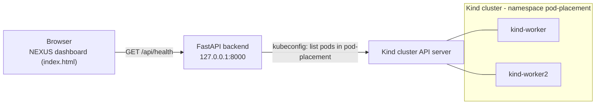

### 6.2 How the pieces work together

- The **Kind cluster** runs the Kubernetes workloads. The `frontend` and `backend` Deployments in `k8s/` are what the scheduler places onto nodes.
- The **FastAPI backend runs on the host machine** (started with Uvicorn at `127.0.0.1:8000`), not inside the cluster. For `/api/pods` it loads the local kubeconfig (`config.load_kube_config()`) and lists the Pods in `pod-placement`.
- The **NEXUS dashboard** is a static HTML file opened in the browser. It calls `http://127.0.0.1:8000/api/health` to show whether the backend is reachable.
- The Pods created by the two Deployments use the stock `nginx:1.27-alpine` image. They exist to demonstrate **scheduling behaviour**; the FastAPI application and the HTML dashboard are **not** packaged into these containers.

### 6.3 Final Pod placement observed in the experiments

```
Kind cluster
├── kind-control-plane   (control plane; not used for these Pods)
├── kind-worker          frontend-767cf6f78c-zhmwd
│                        backend-79fc7c5dbc-qzxd4
│                        backend-79fc7c5dbc-7bdn8
├── kind-worker2         backend-79fc7c5dbc-hq26q
└── (Pending)            backend-7db5778b6c-7s8lv   <- blocked by required anti-affinity
```

---

## 7. Project Folder Structure

```
Kubernets Eval2/
├── README.md                      <- this file
├── k8s/
│   ├── namespace.yaml             Namespace: pod-placement
│   ├── backend.yaml               Deployment: backend (3 replicas, required Pod Anti-Affinity)
│   └── frontend.yaml              Deployment: frontend (1 replica, preferred Pod Affinity)
├── app/
│   ├── backend/
│   │   ├── main.py                FastAPI application (NEXUS API)
│   │   ├── requirements.txt       fastapi, uvicorn[standard], kubernetes
│   │   └── __pycache__/           Auto-generated Python bytecode cache
│   └── frontend/
│       └── index.html             NEXUS dashboard (HTML, CSS, JavaScript)
├── results/
│   ├── baseline.txt               Pod placement before anti-affinity
│   ├── anti-affinity.txt          Placement with 2 backend Pods under the soft rule
│   ├── limited-nodes.txt          3 backend Pods on only 2 worker nodes
│   ├── hard-anti-affinity.txt     Placement after the hard rule: one Pod Pending
│   ├── final-placement.txt        Final cluster state
│   └── deployment-status.txt      kubectl get deployment output (3/3 ready, 1 up-to-date)
└── screenshots/                   14 screenshots (listed in Section 19)
```

---

## 8. Kubernetes Cluster Setup

### 8.1 Cluster layout used in this project

The `kubectl get nodes -o wide` screenshot (`screenshots/Kubernetes cluster nodes.png`) shows this cluster:

| Node | Role | Status | Internal IP |
|---|---|---|---|
| `kind-control-plane` | control-plane | Ready | 172.19.0.4 |
| `kind-worker` | worker | Ready | 172.19.0.3 |
| `kind-worker2` | worker | Ready | 172.19.0.2 |

Pods in this project are scheduled only onto the two workers. The scheduler event in `screenshots/10-failed-scheduling.png` reports `1 node(s) had untolerated taint(s)`, which matches the Kind control-plane node being tainted so that normal workloads do not run on it.

> **Note:** The submitted project folder does not contain a Kind configuration file. The steps below describe how to recreate the same 1 control-plane + 2 worker layout. The cluster name `kind` (the default) produces the node names `kind-control-plane`, `kind-worker`, and `kind-worker2` seen in the screenshots.

### 8.2 Prerequisites

Install **Docker Desktop**, **Kind**, **kubectl**, and **Python**. Then verify in Command Prompt:

```cmd
docker --version
kind --version
kubectl version --client
python --version
```

Docker Desktop must be running before creating the cluster.

### 8.3 Create the Kind cluster

Create a cluster configuration file named `kind-config.yaml` (for example in the project root) with one control-plane node and two workers:

```cmd
(
echo kind: Cluster
echo apiVersion: kind.x-k8s.io/v1alpha4
echo nodes:
echo - role: control-plane
echo - role: worker
echo - role: worker
) > kind-config.yaml
```

Create the cluster from that file:

```cmd
kind create cluster --config kind-config.yaml
```

### 8.4 Use and verify the cluster

```cmd
kind get clusters
kubectl cluster-info --context kind-kind
kubectl config current-context
kubectl get nodes -o wide
```

Expected result: three nodes (`kind-control-plane`, `kind-worker`, `kind-worker2`) in the `Ready` state, and the current context `kind-kind`. The FastAPI endpoint `/api/pods` uses this same kubeconfig context, so it must point at the Kind cluster.

### 8.5 Delete the cluster (when finished)

```cmd
kind delete cluster
```

---

## 9. Namespace Configuration

All resources live in the namespace **`pod-placement`**, which keeps the experiment separate from other workloads and makes cleanup easy.

**`k8s/namespace.yaml`**

```yaml
apiVersion: v1
kind: Namespace
metadata:
  name: pod-placement
```

Create and verify it:

```cmd
kubectl apply -f k8s\namespace.yaml
kubectl get namespace pod-placement
```

Both Deployment manifests set `namespace: pod-placement`, and the FastAPI code reads Pods only from `pod-placement` and reports `"namespace": "pod-placement"` in `/api/info` and `/api/pods`.

Optional: make it the default namespace for the current context so `-n pod-placement` can be omitted:

```cmd
kubectl config set-context --current --namespace=pod-placement
```

The commands in this README keep the explicit `-n pod-placement` flag for clarity.

---

## 10. Pod Affinity: Explanation and Implementation

### 10.1 Concept

**Pod Affinity** tells the scheduler to place a Pod **close to other Pods** that match a label selector. "Close" is defined by the **topology key**. Here the key is `kubernetes.io/hostname`, so "close" means **on the same node**.

### 10.2 Implementation in this project

The `frontend` Deployment prefers to run on the same node as a Pod labelled `app: backend`.

**`k8s/frontend.yaml`**

```yaml
apiVersion: apps/v1
kind: Deployment
metadata:
  name: frontend
  namespace: pod-placement
spec:
  replicas: 1
  selector:
    matchLabels:
      app: frontend
  template:
    metadata:
      labels:
        app: frontend
    spec:
      affinity:
        podAffinity:
          preferredDuringSchedulingIgnoredDuringExecution:
            - weight: 100
              podAffinityTerm:
                labelSelector:
                  matchExpressions:
                    - key: app
                      operator: In
                      values:
                        - backend
                topologyKey: kubernetes.io/hostname
      containers:
        - name: frontend
          image: nginx:1.27-alpine
          ports:
            - containerPort: 80
          resources:
            requests:
              cpu: "100m"
              memory: "64Mi"
            limits:
              cpu: "250m"
              memory: "128Mi"
```

### 10.3 Field-by-field explanation

| Field | Value | Meaning |
|---|---|---|
| `podAffinity` | - | Attract this Pod towards matching Pods |
| `preferredDuringSchedulingIgnoredDuringExecution` | - | **Soft** rule: the scheduler tries to follow it but may ignore it |
| `weight` | `100` | Strength of the preference (range 1 to 100); 100 is the highest |
| `labelSelector.matchExpressions` | `app In [backend]` | Targets Pods labelled `app: backend` |
| `topologyKey` | `kubernetes.io/hostname` | Co-location unit is a single node |
| `replicas` | `1` | One frontend Pod |
| `resources` | requests 100m CPU / 64Mi, limits 250m CPU / 128Mi | Resource requests and limits for the container |

### 10.4 Observation from the experiments

In every snapshot stored in `results/`, the frontend Pod shares a node with at least one backend Pod (on `kind-worker2` in `baseline.txt`, on `kind-worker` in the other files). This is consistent with the preferred affinity. Because the cluster has only two schedulable workers and a preferred rule is not a guarantee, these results show the behaviour is *consistent with* the rule rather than proving the rule alone caused it.

---

## 11. Pod Anti-Affinity: Explanation and Implementation

### 11.1 Concept

**Pod Anti-Affinity** tells the scheduler to keep a Pod **away from** other Pods that match a label selector. With `kubernetes.io/hostname` as the topology key, matching Pods are kept on **different nodes**. This is typically used so replicas of the same service do not share a single point of failure.

### 11.2 Implementation in this project

The `backend` Deployment has 3 replicas and a **required** rule that no two Pods labelled `app: backend` may share a node.

**`k8s/backend.yaml`**

```yaml
apiVersion: apps/v1
kind: Deployment
metadata:
  name: backend
  namespace: pod-placement
spec:
  replicas: 3
  selector:
    matchLabels:
      app: backend
  template:
    metadata:
      labels:
        app: backend
    spec:
      affinity:
        podAntiAffinity:
          requiredDuringSchedulingIgnoredDuringExecution:
            - labelSelector:
                matchExpressions:
                  - key: app
                    operator: In
                    values:
                      - backend
              topologyKey: kubernetes.io/hostname
      containers:
        - name: backend
          image: nginx:1.27-alpine
          ports:
            - containerPort: 80
          resources:
            requests:
              cpu: "100m"
              memory: "64Mi"
            limits:
              cpu: "250m"
              memory: "128Mi"
```

### 11.3 Field-by-field explanation

| Field | Value | Meaning |
|---|---|---|
| `podAntiAffinity` | - | Repel this Pod from matching Pods |
| `requiredDuringSchedulingIgnoredDuringExecution` | - | **Hard** rule: a Pod that cannot satisfy it is **not scheduled** |
| `labelSelector.matchExpressions` | `app In [backend]` | Matches other backend Pods |
| `topologyKey` | `kubernetes.io/hostname` | At most one matching Pod per node |
| `replicas` | `3` | Three backend Pods requested |

### 11.4 The preferred (soft) form

The soft-rule manifest used in the earlier experiments (`anti-affinity.txt`, `limited-nodes.txt`) was replaced when `k8s/backend.yaml` was changed to the required rule, so only the required version is stored in the project. For reference, a preferred Pod Anti-Affinity rule uses this structure (the `weight` below is an illustrative value, not taken from the project files):

```yaml
      affinity:
        podAntiAffinity:
          preferredDuringSchedulingIgnoredDuringExecution:
            - weight: 100
              podAffinityTerm:
                labelSelector:
                  matchExpressions:
                    - key: app
                      operator: In
                      values:
                        - backend
                topologyKey: kubernetes.io/hostname
```

---

## 12. Soft vs Hard Scheduling Rules

Kubernetes expresses both kinds of rule through the field name:

| Rule type | Field name | Behaviour |
|---|---|---|
| **Soft** (preferred) | `preferredDuringSchedulingIgnoredDuringExecution` | Scheduler tries to honour the rule; if it cannot, the Pod is still scheduled |
| **Hard** (required) | `requiredDuringSchedulingIgnoredDuringExecution` | Scheduler must honour the rule; if it cannot, the Pod stays `Pending` |

In both names, `IgnoredDuringExecution` means that a rule is only checked **when a Pod is being scheduled**. Pods that are already running are not moved or evicted if the situation changes later.

### 12.1 Preferred vs Required Pod Anti-Affinity

| Aspect | Preferred (soft) Anti-Affinity | Required (hard) Anti-Affinity |
|---|---|---|
| YAML field | `preferredDuringSchedulingIgnoredDuringExecution` | `requiredDuringSchedulingIgnoredDuringExecution` |
| Structure | List of `weight` + `podAffinityTerm` entries | List of terms (`labelSelector` + `topologyKey`) |
| Is it a guarantee? | No, it is a preference | Yes, it is a constraint |
| Uses `weight`? | Yes (1 to 100) | No |
| When the rule cannot be met | Pod is scheduled anyway (replicas may share a node) | Pod stays `Pending` with a `FailedScheduling` event |
| Replicas vs available nodes | More replicas than nodes still run | Replicas beyond the number of eligible nodes do not run |
| Availability | Higher: Pods keep running | Lower when nodes are scarce: some replicas never start |
| Placement strictness | Best-effort spreading | Strict spreading |
| Best used when | Spreading is desirable but the service must always run | Two Pods must never share a node |
| **Result in this project** | 3 backend replicas became `Running` on only 2 workers; `qzxd4` and `7bdn8` both landed on `kind-worker` (`limited-nodes.txt`) | New backend Pod `backend-7db5778b6c-7s8lv` stayed `0/1 Pending`; event: `0/3 nodes are available: 1 node(s) had untolerated taint(s), 2 node(s) didn't match pod anti-affinity rules` (`hard-anti-affinity.txt`, `10-failed-scheduling.png`) |

### 12.2 Why the hard rule leaves a Pod Pending here

The cluster has only **two schedulable worker nodes**, but the `backend` Deployment asks for **three** replicas that may not share a node. Two replicas can be placed (one per worker); the third has no valid node:

- The control-plane node is excluded by an untolerated taint.
- Both workers already host a backend Pod, so they fail the anti-affinity rule.

Hence the scheduler message: `0/3 nodes are available: 1 node(s) had untolerated taint(s), 2 node(s) didn't match pod anti-affinity rules`.

---

## 13. Experimental Setup and Results

### 13.1 Setup

| Item | Value |
|---|---|
| Cluster | Kind: `kind-control-plane`, `kind-worker`, `kind-worker2` |
| Namespace | `pod-placement` |
| Frontend | 1 replica, preferred Pod Affinity towards `app=backend` |
| Backend | 2 replicas in the first experiments, then 3 replicas |
| Topology key | `kubernetes.io/hostname` (one node = one topology domain) |
| Image | `nginx:1.27-alpine` for all Pods |
| Observation command | `kubectl get pods -n pod-placement -o wide` |

The result files contain `kubectl get pods -n pod-placement -o wide` output (and, for `deployment-status.txt`, `kubectl get deployment backend -n pod-placement`, as shown in `screenshots/Kubernetes cluster nodes.png`).

### 13.2 Experiment A: Baseline (`results/baseline.txt`)

| Pod | Status | Node | IP |
|---|---|---|---|
| `backend-76cc779d46-vbnnk` | Running | `kind-worker` | 10.244.2.5 |
| `backend-76cc779d46-wqfzx` | Running | `kind-worker2` | 10.244.1.5 |
| `frontend-7d94488fbd-xt9qf` | Running | `kind-worker2` | 10.244.1.6 |

**Observation:** The two backend Pods are on different workers, and the frontend is on the same node as one backend Pod (`kind-worker2`). The baseline manifest for this first revision was not preserved in `k8s/`, so only the observed placement is documented.

### 13.3 Experiment B: Soft anti-affinity with 2 backend replicas (`results/anti-affinity.txt`, `screenshots/06-soft-anti-affinity.png`)

| Pod | Status | Node | IP |
|---|---|---|---|
| `backend-79fc7c5dbc-hq26q` | Running | `kind-worker2` | 10.244.1.7 |
| `backend-79fc7c5dbc-qzxd4` | Running | `kind-worker` | 10.244.2.7 |
| `frontend-767cf6f78c-zhmwd` | Running | `kind-worker` | 10.244.2.6 |

**Observation:** With two nodes available, the two backend replicas are separated onto different workers, and the frontend sits with a backend Pod on `kind-worker`.

### 13.4 Experiment C: Three replicas on limited nodes (`results/limited-nodes.txt`, `screenshots/07-three-replicas.png`)

| Pod | Status | Node | IP |
|---|---|---|---|
| `backend-79fc7c5dbc-7bdn8` | Running | `kind-worker` | 10.244.2.8 |
| `backend-79fc7c5dbc-hq26q` | Running | `kind-worker2` | 10.244.1.7 |
| `backend-79fc7c5dbc-qzxd4` | Running | `kind-worker` | 10.244.2.7 |
| `frontend-767cf6f78c-zhmwd` | Running | `kind-worker` | 10.244.2.6 |

**Observation:** All three backend replicas are `Running`, but two of them (`7bdn8` and `qzxd4`) share `kind-worker`. This can only happen when the anti-affinity rule is **soft**: the scheduler could not give every replica its own node, so it placed the third where it could. These three Pods carry the same pod-template-hash (`79fc7c5dbc`) as in Experiment B, so they come from the same Pod template; the scale from 2 to 3 replicas did not change the template.

### 13.5 Experiment D: Hard (required) anti-affinity (`results/hard-anti-affinity.txt`, `screenshots/08-hard-anti-affinity-yaml.png`, `screenshots/09-pending-pod.png`)

After `k8s/backend.yaml` was changed to `requiredDuringSchedulingIgnoredDuringExecution`:

| Pod | Status | Node | IP |
|---|---|---|---|
| `backend-79fc7c5dbc-7bdn8` | Running | `kind-worker` | 10.244.2.8 |
| `backend-79fc7c5dbc-hq26q` | Running | `kind-worker2` | 10.244.1.7 |
| `backend-79fc7c5dbc-qzxd4` | Running | `kind-worker` | 10.244.2.7 |
| `backend-7db5778b6c-7s8lv` | **Pending** (`0/1`) | `<none>` | `<none>` |
| `frontend-767cf6f78c-zhmwd` | Running | `kind-worker` | 10.244.2.6 |

**Observation:**

- The changed Pod template produced a **new ReplicaSet** (hash `7db5778b6c`). Its new Pod `backend-7db5778b6c-7s8lv` could not be scheduled and stayed `Pending` with no node and no IP.
- The three older Pods (hash `79fc7c5dbc`) kept running. Because the rule is `IgnoredDuringExecution`, existing Pods are not evicted, so `qzxd4` and `7bdn8` still share `kind-worker`.

### 13.6 Scheduler event (`screenshots/10-failed-scheduling.png`)

`kubectl describe` on the Pending Pod shows `PodScheduled: False` and repeated `FailedScheduling` warnings from the `default-scheduler`:

```
0/3 nodes are available: 1 node(s) had untolerated taint(s), 2 node(s) didn't match pod anti-affinity rules.
preemption: 0/3 nodes are available: 1 Preemption is not helpful for scheduling, 2 No preemption victims found for incoming pod.
```

The event is recorded at 50m and again at 10m (`x8 over 45m`), so the scheduler kept retrying and the Pod never became schedulable.

### 13.7 Final state and deployment status (`results/final-placement.txt`, `results/deployment-status.txt`)

`final-placement.txt` is the same picture as Experiment D, with the new backend Pod still `Pending` after 32 minutes. The `kubectl get pods` screenshots (`05-running-pods.png..png`, `All pods and their nodes.png`, and `09-pending-pod.png`) show the same Pending Pod at 46m, 38m, and 49m of age, so the condition was persistent.

`deployment-status.txt`:

```
NAME      READY   UP-TO-DATE   AVAILABLE   AGE
backend   3/3     1            3           73m
```

This shows 3 of 3 Pods ready and available (the three older Pods), while only **1** Pod is up to date with the new template (the Pending one). The rollout is therefore stalled. This is the default Deployment rolling-update behaviour: old Pods are kept until the new Pod becomes ready, and here the new Pod cannot be scheduled.

### 13.8 Summary of conclusions

| # | Conclusion | Evidence |
|---|---|---|
| 1 | With enough nodes, anti-affinity spreads backend replicas across nodes | `anti-affinity.txt`, `baseline.txt` |
| 2 | A **soft** rule lets extra replicas share a node, so the application stays available | `limited-nodes.txt` |
| 3 | A **hard** rule leaves replicas `Pending` when there are not enough eligible nodes | `hard-anti-affinity.txt`, `final-placement.txt`, `10-failed-scheduling.png` |
| 4 | A stalled hard-rule rollout leaves old Pods running and the Deployment partly updated | `deployment-status.txt` |
| 5 | The frontend was co-located with a backend Pod in every recorded snapshot, consistent with the preferred Pod Affinity | All `results/*.txt` |
| 6 | Resolving the Pending state needs either another worker node, fewer replicas, or a soft rule | Follows from the scheduler message |

---

## 14. FastAPI Backend: Features and API Endpoints

**File:** `app/backend/main.py`  
**Dependencies (`app/backend/requirements.txt`):** `fastapi`, `uvicorn[standard]`, `kubernetes`

### 14.1 Features

- FastAPI application titled **NEXUS API**, version **2.0.0**, described as "Kubernetes Pod Placement Monitoring API".
- **CORS** is enabled for all origins, methods, and headers (`allow_origins=["*"]`), so the dashboard can call the API from a local HTML file.
- Reads live Pod data from the cluster in the `pod-placement` namespace using the official Kubernetes Python client and the local kubeconfig.
- Errors while contacting Kubernetes are caught and returned as a JSON message instead of crashing the API.
- Automatic interactive documentation at `http://127.0.0.1:8000/docs`.

### 14.2 Endpoints

| Method | Endpoint | Description |
|---|---|---|
| GET | `/` | Returns the application name, status, and a short message |
| GET | `/api/health` | Returns service health with a UTC timestamp |
| GET | `/api/info` | Returns project metadata (platform, namespace, technologies, scheduling strategies) |
| GET | `/api/pods` | Returns live Pods in `pod-placement` with status, node, IP, and labels |

The automatically generated docs are served by FastAPI at `/docs`, and the OpenAPI schema at `/openapi.json`. These four endpoints are exactly the ones listed in `screenshots/11-fastapi-docs.png`.

### 14.3 Response examples (from the code)

**`GET /`**

```json
{
  "application": "NEXUS",
  "status": "Running",
  "message": "Kubernetes Pod Placement Monitor API"
}
```

**`GET /api/health`** (see `screenshots/12-backend-health.png`)

```json
{
  "service": "Backend",
  "status": "Healthy",
  "timestamp": "2026-11-14T05:40:15.519570+00:00"
}
```

**`GET /api/info`**

```json
{
  "application": "NEXUS",
  "platform": "Kubernetes",
  "namespace": "pod-placement",
  "frontend": "HTML, CSS, JavaScript",
  "backend": "Python FastAPI",
  "scheduling": [
    "Pod Affinity",
    "Preferred Pod Anti-Affinity",
    "Required Pod Anti-Affinity"
  ]
}
```

**`GET /api/pods`** (structure from the code; the live output is in `screenshots/13-live-pods-api.png`)

```json
{
  "namespace": "pod-placement",
  "total_pods": 5,
  "pods": [
    {
      "name": "backend-79fc7c5dbc-7bdn8",
      "status": "Running",
      "node": "kind-worker",
      "ip": "10.244.2.8",
      "labels": { "app": "backend", "pod-template-hash": "79fc7c5dbc" }
    }
  ]
}
```

For a Pod that is not yet scheduled (such as the Pending backend Pod), the API returns `"node": "Not Scheduled"` and `"ip": "Not Assigned"`, as seen in the live screenshot.

If the cluster cannot be reached (for example, Kind is not running or the kubeconfig is wrong), `/api/pods` responds with:

```json
{
  "error": "<exception text>",
  "message": "Unable to retrieve Kubernetes Pods"
}
```

### 14.4 Notes

- The Pods endpoint only **lists** Pods. It does not create, modify, or delete anything.
- Because it uses `config.load_kube_config()`, the backend must run on a machine whose kubeconfig points to the Kind cluster.

---

## 15. Frontend Dashboard: NEXUS

**File:** `app/frontend/index.html` (single file with inline HTML, CSS, and JavaScript)


### 15.1 What the dashboard contains

| Section | Content |
|---|---|
| Header | NEXUS logo, "CLOUD INFRASTRUCTURE MONITOR", and a live **Backend Connected / Backend Disconnected** indicator |
| Hero | "Pod Placement Monitor" with a short description of Pod Affinity and Anti-Affinity |
| Infrastructure Overview | Four cards: Cluster (KIND), Frontend (01), Backend Target (02), Namespace (`pod-placement`) |
| Cluster Topology | Panel showing `kind-worker` (Frontend Pod, Backend Pod) and `kind-worker2` (Backend Pod) |
| Scheduling Policies | Short explanations of Pod Affinity, Preferred Anti-Affinity, and Required Anti-Affinity |
| Backend Connectivity | "FastAPI Health Check" and "Backend Response" status lines with a **Refresh Connection** button |

### 15.2 How it talks to the backend

On page load, and whenever **Refresh Connection** is clicked, the dashboard calls:

```
GET http://127.0.0.1:8000/api/health
```

- On success it shows the returned status, "Connected", and a green **Backend Connected** indicator.
- On failure it shows "Offline" / "Unavailable" and a red **Backend Disconnected** indicator.

The dashboard therefore requires the FastAPI backend to be running at `127.0.0.1:8000`.

### 15.3 Important accuracy notes

- The **Cluster Topology** panel is a fixed illustration. The page itself states: "Topology shown as an illustrative layout. Live placement data will be connected in the next integration step." It does not call `/api/pods`.
- The **Backend Target** card shows `02` as a static value, while `k8s/backend.yaml` sets `replicas: 3`.
- Live Pod placement data is available through the `/api/pods` endpoint (`screenshots/13-live-pods-api.png`) rather than on the dashboard.
- The Inter font is loaded from Google Fonts, so the intended typography requires an internet connection; the page falls back to the browser's sans-serif font otherwise.

---

## 16. Installation and Execution Steps

Run all commands in **Windows Command Prompt**. The project folder in the screenshots is `D:\5th Sem\Cloud Computing\Kubernets Eval2`; adjust the path if yours is different.

**Step 1: Go to the project root**

```cmd
cd /d "D:\5th Sem\Cloud Computing\Kubernets Eval2"
```

**Step 2: Start Docker Desktop**, then create the Kind cluster (see [Section 8](#8-kubernetes-cluster-setup)):

```cmd
kind create cluster --config kind-config.yaml
kubectl get nodes -o wide
```

**Step 3: Deploy the Kubernetes resources** (see [Section 17](#17-commands-to-deploy-kubernetes-resources)):

```cmd
kubectl apply -f k8s\namespace.yaml
kubectl apply -f k8s\backend.yaml
kubectl apply -f k8s\frontend.yaml
kubectl get pods -n pod-placement -o wide
```

**Step 4: Install the backend dependencies and start FastAPI** (see [Section 18](#18-how-to-run-the-frontend-and-backend)):

```cmd
cd app\backend
python -m venv venv
venv\Scripts\activate
pip install -r requirements.txt
uvicorn main:app --host 127.0.0.1 --port 8000 --reload
```

**Step 5: Verify the API.** Open `http://127.0.0.1:8000/docs` in a browser.

**Step 6: Open the dashboard.** In a **new** Command Prompt window:

```cmd
cd /d "D:\5th Sem\Cloud Computing\Kubernets Eval2"
start app\frontend\index.html
```

---

## 17. Commands to Deploy Kubernetes Resources

### 17.1 Apply the manifests

> **Apply `namespace.yaml` first.** If you run `kubectl apply -f k8s\` on the whole folder, files are processed in alphabetical order (`backend.yaml`, `frontend.yaml`, `namespace.yaml`), so the Deployments would be created before the namespace exists and fail.

```cmd
kubectl apply -f k8s\namespace.yaml
kubectl apply -f k8s\backend.yaml
kubectl apply -f k8s\frontend.yaml
```

### 17.2 Verify the deployment

```cmd
kubectl get namespace pod-placement
kubectl get deployments -n pod-placement
kubectl get pods -n pod-placement -o wide
kubectl get pods -n pod-placement --show-labels
```

### 17.3 Expected outcome with the manifests as stored

With `k8s/backend.yaml` (required anti-affinity, 3 replicas) on the 2-worker Kind cluster:

- 2 backend Pods become `Running`, one on each worker.
- The 3rd backend Pod stays `Pending`.
- The frontend Pod is `Running`, preferably on the same node as a backend Pod.

### 17.4 Investigate a Pending Pod

Replace the Pod name with the one shown by `kubectl get pods`:

```cmd
kubectl describe pod backend-7db5778b6c-7s8lv -n pod-placement
kubectl get events -n pod-placement
```

Look for the `FailedScheduling` warning described in [Section 13.6](#136-scheduler-event-screenshots10-failed-schedulingpng).

### 17.5 Save output to the `results` folder

The results files are plain-text captures of `kubectl` output. The screenshots show output redirected in this way:

```cmd
kubectl get deployment backend -n pod-placement > results\deployment-status.txt
kubectl get pods -n pod-placement -o wide > results\final-placement.txt
```

### 17.6 Reproduce the soft-rule experiment

1. Edit the `affinity:` block of `k8s\backend.yaml` to the preferred form shown in [Section 11.4](#114-the-preferred-soft-form).
2. Re-apply the file:

```cmd
kubectl apply -f k8s\backend.yaml
kubectl get pods -n pod-placement -o wide
```

Because this edits the stored manifest, keep a copy of the original `backend.yaml` first if you want to return to the hard-rule version.

### 17.7 Clean up

```cmd
kubectl delete -f k8s\frontend.yaml
kubectl delete -f k8s\backend.yaml
kubectl delete -f k8s\namespace.yaml
```

Deleting the namespace alone also removes everything inside it:

```cmd
kubectl delete namespace pod-placement
```

---

## 18. How to Run the Frontend and Backend

### 18.1 Backend (FastAPI)

Prerequisites: the Kind cluster is running, and `kubectl config current-context` shows the Kind context (`kind-kind`).

```cmd
cd /d "D:\5th Sem\Cloud Computing\Kubernets Eval2\app\backend"
python -m venv venv
venv\Scripts\activate
pip install -r requirements.txt
uvicorn main:app --host 127.0.0.1 --port 8000 --reload
```

If `uvicorn` is not recognised as a command, use:

```cmd
python -m uvicorn main:app --host 127.0.0.1 --port 8000 --reload
```

The command works because the module is `main.py` and the FastAPI object inside it is named `app`.

| URL | Purpose |
|---|---|
| `http://127.0.0.1:8000/docs` | Interactive API documentation (Swagger UI) |
| `http://127.0.0.1:8000/openapi.json` | OpenAPI schema |
| `http://127.0.0.1:8000/api/health` | Health check |
| `http://127.0.0.1:8000/api/info` | Application information |
| `http://127.0.0.1:8000/api/pods` | Live Pods in `pod-placement` |

### 18.2 Frontend (NEXUS dashboard)

The dashboard is a static file. With the backend running, open it from a second Command Prompt:

```cmd
cd /d "D:\5th Sem\Cloud Computing\Kubernets Eval2"
start app\frontend\index.html
```

You can also double-click `app\frontend\index.html` in File Explorer. The header indicator should turn to **Backend Connected**. If it shows **Backend Disconnected**, check that Uvicorn is running on port 8000, then click **Refresh Connection**.

### 18.3 Quick troubleshooting

| Symptom | Likely cause | What to do |
|---|---|---|
| Dashboard shows **Backend Disconnected** | FastAPI is not running or is on another port | Start Uvicorn on `127.0.0.1:8000` |
| `/api/pods` returns `"error"` and "Unable to retrieve Kubernetes Pods" | Kind cluster not running, or kubeconfig points elsewhere | Run `kubectl get nodes` and `kubectl config current-context` |
| One backend Pod is `Pending` | Required anti-affinity with 3 replicas but only 2 worker nodes | Expected behaviour; see [Section 12.2](#122-why-the-hard-rule-leaves-a-pod-pending-here) |
| `namespaces "pod-placement" not found` | Deployments were applied before the namespace | Apply `k8s\namespace.yaml` first |

---

## 19. Screenshots Section

All screenshots are in the `screenshots/` folder. The filenames below are exactly as they appear in the project, including the spaces and the double extension on `05-running-pods.png..png`.

> The links use `%20` for spaces so they render on GitHub.

### 19.1 Screenshot index

| # | File | What it shows |
|---|---|---|
| 1 | `Kubernetes cluster nodes.png` | `kubectl get nodes -o wide`: control-plane, `kind-worker`, `kind-worker2` all `Ready` |
| 2 | `baseline.png` | Baseline Pod placement (matches `results/baseline.txt`) |
| 3 | `All pods and their nodes.png` | `kubectl get pods -n pod-placement -o wide` with the Pending Pod (38m) |
| 4 | `04-frontend-affinity.png` | `k8s/frontend.yaml` in VS Code showing the preferred Pod Affinity rule |
| 5 | `05-running-pods.png..png` | `kubectl get pods` output: three Running backend Pods, one Pending, frontend Running (46m) |
| 6 | `06-soft-anti-affinity.png` | Placement under the soft rule (matches `results/anti-affinity.txt`) |
| 7 | `07-three-replicas.png` | Three backend replicas Running on two nodes (matches `results/limited-nodes.txt`) |
| 8 | `08-hard-anti-affinity-yaml.png` | `k8s/backend.yaml` showing `requiredDuringSchedulingIgnoredDuringExecution` |
| 9 | `09-pending-pod.png` | Pods listing with `backend-7db5778b6c-7s8lv` in `Pending` (49m) |
| 10 | `10-failed-scheduling.png` | `kubectl describe` output with the `FailedScheduling` events |
| 11 | `11-fastapi-docs.png` | FastAPI Swagger UI listing `/`, `/api/health`, `/api/info`, `/api/pods` |
| 12 | `12-backend-health.png` | JSON response from `/api/health` |
| 13 | `13-live-pods-api.png` | JSON response from `/api/pods` with all five Pods |
| 14 | `14.Nexus Dashboard.png` | NEXUS dashboard with "Backend Connected" |

### 19.2 Cluster

**Kubernetes cluster nodes**


### 19.3 Baseline and affinity

**Baseline placement**

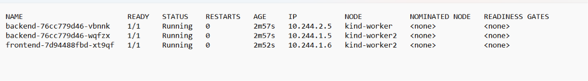

**Frontend Pod Affinity manifest**

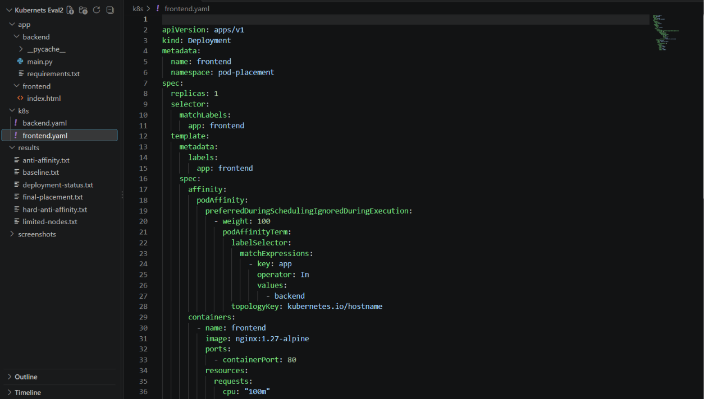

### 19.4 Anti-affinity experiments

**Running Pods**

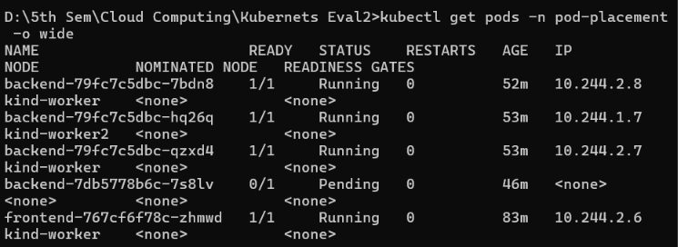

**Soft (preferred) anti-affinity**

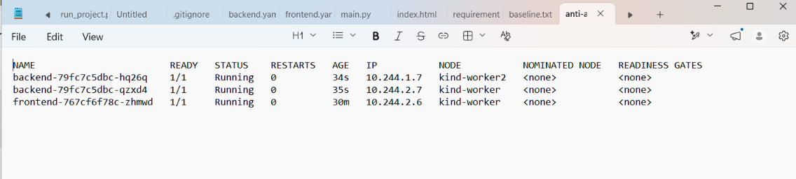

**Three replicas on limited nodes**

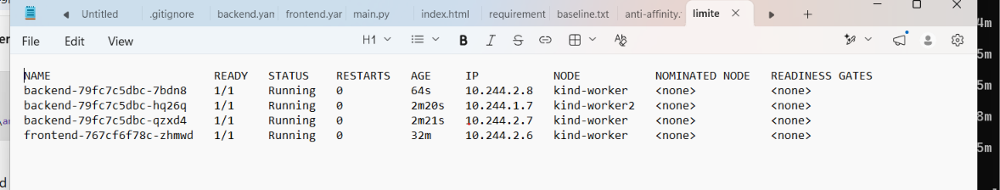

**Hard (required) anti-affinity manifest**

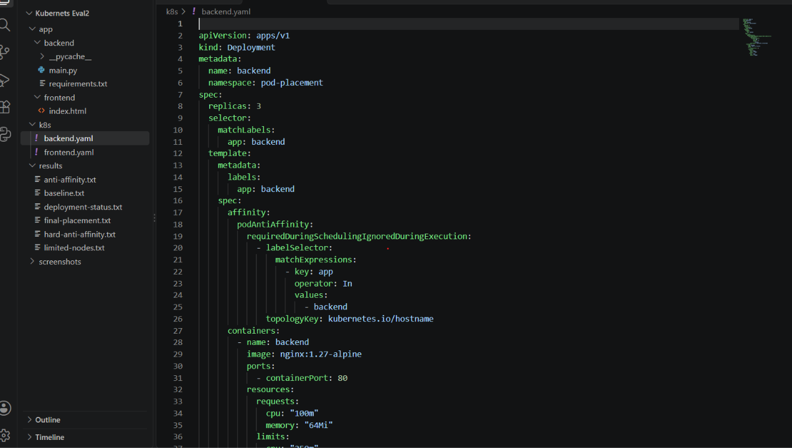

**Pending Pod**

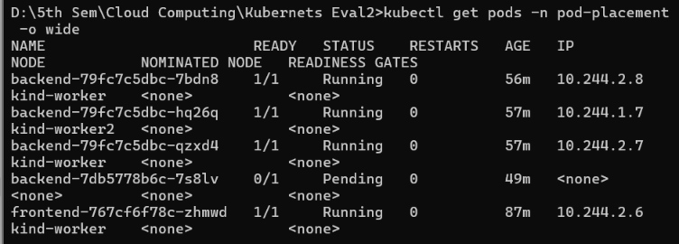

**FailedScheduling event**

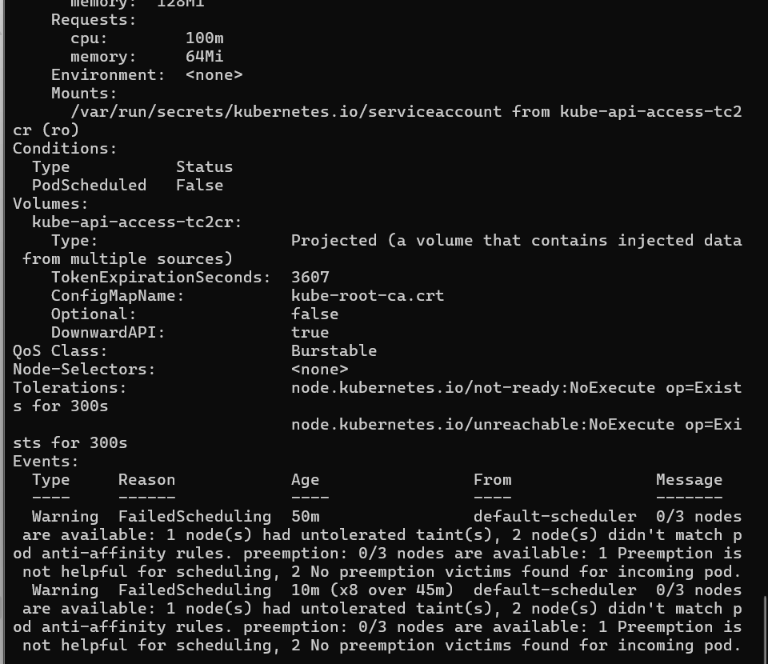

**All Pods and their nodes**


### 19.5 Backend and dashboard

**FastAPI documentation (`/docs`)**

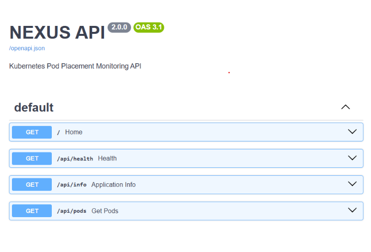

**Backend health (`/api/health`)**

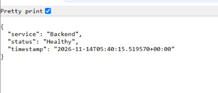

**Live Pods API (`/api/pods`)**

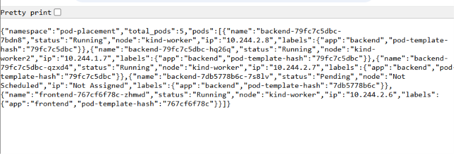

**NEXUS dashboard**


---

## 20. Advantages

- **Fault tolerance:** Anti-affinity keeps backend replicas on separate nodes where possible, so one node failure does not remove every replica.
- **Locality:** Preferred Pod Affinity places the frontend on the same node as a backend Pod without making that a hard requirement.
- **Flexible strictness:** Using a soft rule for the frontend and a hard rule for the backend shows how to balance availability against strict placement.
- **Declarative and repeatable:** Placement logic lives in YAML manifests, so the same behaviour can be reproduced on any Kind cluster with the same layout.
- **Isolation:** Everything runs in the dedicated `pod-placement` namespace and can be removed with one command.
- **Observability:** The `/api/pods` endpoint exposes each Pod's node, IP, status, and labels, making placement easy to inspect.
- **Documented evidence:** The `results/` and `screenshots/` folders capture each stage of the experiment, including the failure case.
- **Lightweight setup:** Runs entirely on a single machine with Docker, Kind, and Python.

---

## 21. Limitations

- **Small cluster.** Only two worker nodes are available, so the required anti-affinity rule cannot place a third backend replica.
- **Stalled rollout.** The experiment ends with one Pod permanently `Pending` and the Deployment only partly updated (`1` up-to-date, `3` available).
- **Placeholder workloads.** Both Deployments use `nginx:1.27-alpine`. The FastAPI app and dashboard are not packaged as container images or deployed into the cluster.
- **Backend runs outside the cluster.** `/api/pods` depends on the developer's local kubeconfig (`load_kube_config`), so it does not work from inside a Pod as written.
- **Dashboard is partly static.** The topology panel and the "Backend Target: 02" card are hardcoded and do not reflect live data or the 3 replicas in `backend.yaml`. Only the health check is live.
- **No soft-rule manifest saved.** The preferred-anti-affinity manifest used in the earlier experiments was overwritten, so those experiments cannot be replayed from the repository alone.
- **No Kind configuration file** is included in the project folder.
- **Open CORS policy.** The API allows all origins, which is convenient for a lab demo but not suitable for production.
- **No automated tests** are included.
- **Rules apply only at scheduling time.** `IgnoredDuringExecution` means existing Pods are not rebalanced; for example, two older backend Pods still share `kind-worker`.

---

## 22. Future Enhancements

These are suggestions for extending the project; they are **not** implemented in the current code.

- Connect the dashboard's Cluster Topology panel to `/api/pods` so it shows live Pod placement (the page itself notes this as the next integration step).
- Replace the hardcoded replica counts on the dashboard with values read from the cluster.
- Add a third worker node to the Kind configuration so three backend replicas can be placed under the required rule, and store that configuration file in the repository.
- Keep separate manifests for the soft and hard backend variants so each experiment can be replayed exactly.
- Package the FastAPI backend and the dashboard as container images and deploy them to the cluster, using in-cluster configuration (`load_incluster_config`) with a suitably restricted ServiceAccount and RBAC.
- Show scheduler events (such as `FailedScheduling`) in the dashboard.
- Compare with other placement tools such as `nodeAffinity`, taints and tolerations, and topology spread constraints.
- Restrict CORS to the dashboard's origin and add automated tests for the API.

---

## 23. Conclusion

This project demonstrates, on a real multi-node Kind cluster, how Pod Affinity and Pod Anti-Affinity control Kubernetes scheduling in the `pod-placement` namespace. A **preferred** Pod Affinity rule kept the `frontend` Pod on a node that also ran a `backend` Pod. A **soft** anti-affinity rule spread backend replicas across the two workers when possible and still allowed three replicas to run on two nodes. After the rule became **required**, the cluster showed the strict behaviour: a new backend Pod remained `Pending`, and the scheduler reported `FailedScheduling` because `2 node(s) didn't match pod anti-affinity rules`.

The main lesson is that the choice between preferred and required rules is a trade-off between **strict placement** and **availability**: required rules give strict separation but need enough eligible nodes, while preferred rules keep applications running when resources are limited. The FastAPI backend and the NEXUS dashboard make the setup observable, with `/api/pods` exposing live placement data and the dashboard confirming backend connectivity.

---

## 24. Team Members

| Name |
|---|
| Alsaba A |
| Rakshita K |
| Omkar M |
| Harsh H |

**Project:** NEXUS: Kubernetes Pod Placement Monitor  
**Course Work:** Cloud Computing Lab Evaluation 2
